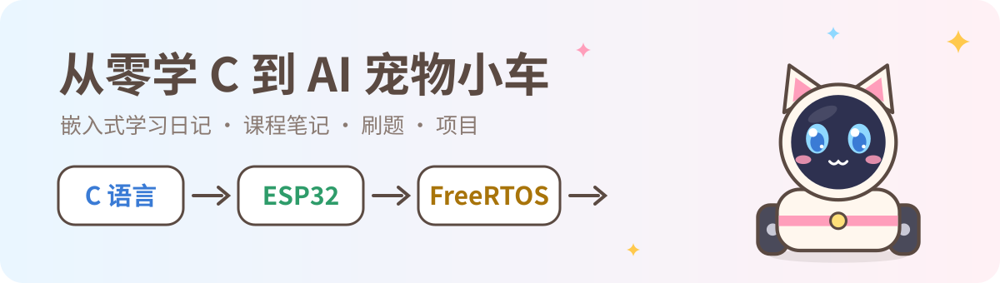
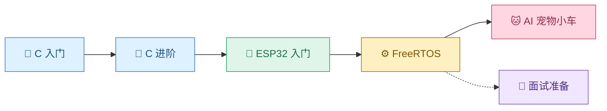

<div align="center">



<br>


**从零学 C 语言，到能在 ESP32-S3 上用 FreeRTOS 做一台会对话的 AI 电子宠物小车。**<br>
这个仓库记录全过程：课程笔记、练习代码、刷题和项目。

</div>

---

## 🗺️ 学习路线



| | 阶段 | 时间 | 学什么 | 去哪里 |
| :-: | --- | --- | --- | --- |
| 📘 | **C 入门** | 2026.11 – 12 中 | 变量、循环、函数、数组、字符串 | [01-c-basics](courses/01-c-basics) |
| 📗 | **C 进阶** | 寒假第 1 周 | 指针、结构体、动态内存、位运算 | [02-c-advanced](courses/02-c-advanced) |
| 🔌 | **ESP32 入门** | 寒假第 1–3 周 | GPIO、中断、PWM、SPI 屏幕、I2S 音频、Wi-Fi | [03-esp32-basics](courses/03-esp32-basics) |
| ⚙️ | **FreeRTOS** | 2027.01 | 任务、队列、信号量、调度 | [04-freertos](courses/04-freertos) |
| 💼 | **面试准备** | 2027.01 – 03 | 嵌入式常见问题、模电数电、射频基础 | [05-interview-prep](courses/05-interview-prep) |
| 🐱 | **项目** | 寒假 – 春季学期 | AI 电子宠物小车（ESP32-S3 + 大模型） | [ai-pet-car](projects/ai-pet-car) |
| 🧩 | **刷题** | 全程，每天 1 题 | LeetCode（用 C 写） | [leetcode](leetcode) |

## 📈 进度

| 📘 C 入门 | 📗 C 进阶 | 🔌 ESP32 | ⚙️ FreeRTOS | 🐱 小车 | 🧩 LeetCode |
| :-: | :-: | :-: | :-: | :-: | :-: |
| ⬜ | ⬜ | ⬜ | ⬜ | ⬜ | 0 / 50 |

<sub>⬜ 没开始 · 🟨 进行中 · ✅ 完成。每周日更新一次，没学完的在对应课程 README 里写一句卡在哪。</sub>

## 🔁 每学完一节课

<table>
<tr>
<td align="center" width="20%">📝<br><b>1. 笔记</b></td>
<td>复制 <a href="courses/NOTE_TEMPLATE.md"><code>courses/NOTE_TEMPLATE.md</code></a> 到对应课程的 <code>notes/</code>，按知识点命名，例如 <code>courses/01-c-basics/notes/03-loops.md</code></td>
</tr>
<tr>
<td align="center">⌨️<br><b>2. 代码</b></td>
<td>把课上的例子自己敲一遍，再写 1–2 个自己的小练习，放进 <code>code/</code>，和笔记同名（<code>03-loops.c</code>）</td>
</tr>
<tr>
<td align="center">✅<br><b>3. 打勾</b></td>
<td>在课程 README 里把学会的知识点 <code>- [ ]</code> 改成 <code>- [x]</code></td>
</tr>
<tr>
<td align="center">🚀<br><b>4. 提交</b></td>
<td><code>git add . && git commit -m "c-basics: loops notes + 2 exercises" && git push</code></td>
</tr>
</table>

> [!IMPORTANT]
> CS50 的 problem set 答案**不要**放进这个公开仓库：CS50 的学术诚信政策不允许公开答案。problem set 放在本地或单独的私有仓库，这里只放笔记和自己写的练习。

<details>
<summary>📁 <b>目录结构和命名约定</b>（点开看看）</summary>

```
.
├── courses/                  # 课程
│   ├── NOTE_TEMPLATE.md      # 笔记模板，每篇笔记从这里复制
│   └── 0X-<course>/
│       ├── README.md         # 大纲 + 知识点清单（学完打勾）
│       ├── notes/            # 笔记，一个知识点一个 .md
│       └── code/             # 练习代码，一个知识点一个 .c
├── leetcode/                 # 刷题，文件名：<题号>-<题目英文名>.c
└── projects/
    └── ai-pet-car/           # AI 电子宠物小车
```

- 笔记文件名：`01-variables.md`、`02-loops.md`，按学习顺序编号，代码文件同名（`01-variables.c`）。
- commit 信息写清楚做了什么，例如 `c-basics: arrays notes + 3 exercises`。

</details>

---

<div align="center">
<br>
<sub>今天也要好好学习哦 ✨</sub>
</div>
