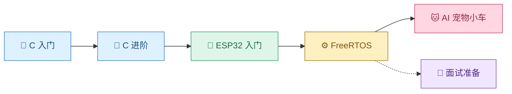

<div align="center">


**从零学 C 语言，到能在 ESP32-S3 上用 FreeRTOS 做一台会对话的 AI 电子宠物小车。**<br>
这个仓库记录全过程：课程笔记、练习代码、刷题和项目。

[📚 课程](courses) &nbsp;·&nbsp; [🧩 刷题](leetcode) &nbsp;·&nbsp; [🐱 项目](projects/ai-pet-car) &nbsp;·&nbsp; [📖 术语表](GLOSSARY.md)

</div>

---

<a id="roadmap"></a>

## 🧭 路线与进度



| | 阶段 | 时间 | 学什么 | 进度 |
| :-: | --- | --- | --- | :-: |
| 📘 | [**C 入门**](courses/01-c-basics) | 2026.11 – 12 中 | 变量、循环、函数、数组、字符串 | 🟨 |
| 📗 | [**C 进阶**](courses/02-c-advanced) | 寒假第 1 周 | 指针、结构体、动态内存、位运算 | ⬜ |
| 🔌 | [**ESP32 入门**](courses/03-esp32-basics) | 寒假第 1–3 周 | GPIO、中断、PWM、SPI 屏幕、I2S 音频、Wi-Fi | ⬜ |
| ⚙️ | [**FreeRTOS**](courses/04-freertos) | 2027.01 | 任务、队列、信号量、调度 | ⬜ |
| 💼 | [**面试准备**](courses/05-interview-prep) | 2027.01 – 03 | 嵌入式常见问题、模电数电、射频基础 | ⬜ |
| 🐱 | [**项目**](projects/ai-pet-car) | 寒假 – 春季学期 | AI 电子宠物小车（ESP32-S3 + 大模型） | ⬜ |
| 🧩 | [**刷题**](leetcode) | 全程，每天 1 题 | LeetCode（用 C 写） | 0 / 50 |

<sub>⬜ 没开始 · 🟨 进行中 · ✅ 完成。每周日更新一次，没学完的在对应课程 README 里写一句卡在哪。</sub>

## 🔁 每天怎么用

| 今天做了什么 | 记在哪里 | 怎么记 |
| --- | --- | --- |
| 📝 学完一个知识点 | [`courses/`](courses) | [笔记 → 代码 → 打勾 → 提交](courses/README.md#flow) |
| 🧩 刷完一道题 | [`leetcode/`](leetcode) | [建文件 → 写题解 → 记一行 → 提交](leetcode/README.md#flow) |
| 🐱 小车有进展 | [`projects/ai-pet-car/`](projects/ai-pet-car) | [开发计划](projects/ai-pet-car/docs/PLAN.md) 里打勾，踩的坑写进 [调试记录](projects/ai-pet-car/docs/devlog) |
| 📈 到了周日 | 上面的 [进度表](#roadmap) | 把 ⬜ 🟨 ✅ 更新一次 |

> [!IMPORTANT]
> CS50 的 problem set 答案**不要**放进这个公开仓库：CS50 的学术诚信政策不允许公开答案。problem set 放在本地或单独的私有仓库，这里只放笔记和自己写的练习。

## 📁 仓库里有什么

```
.
├── README.md                 # 首页：路线、进度、每天怎么用
├── GLOSSARY.md               # 术语表：文档里出现的缩写和名词
├── courses/                  # 课程
│   ├── README.md             # 课程总览：路线、进度、学习流程
│   ├── NOTE_TEMPLATE.md      # 笔记模板，每篇笔记从这里复制
│   └── 0X-<course>/
│       ├── README.md         # 笔记列表 + 知识点清单（学完打勾）
│       ├── notes/            # 笔记，一个知识点一个 .md
│       └── code/             # 练习代码，一个知识点一个 .c
├── leetcode/                 # 刷题，文件名：<题号>-<题目英文名>.c
│   ├── README.md             # 目标、刷题流程、刷题记录
│   └── TEMPLATE.c            # 题解模板，每道题从这里复制
└── projects/
    └── ai-pet-car/           # AI 电子宠物小车
```

**命名约定**

- 笔记文件名：`01-hello-c.md`、`02-input-output.md`，按学习顺序编号，代码文件同名（`01-hello-c.c`）。
- commit 信息写清楚做了什么，例如 `c-basics: arrays notes + 3 exercises`。

---

<div align="center">
<br>
<sub>今天也要好好学习哦 ✨</sub><br>
<sub>横幅里的角色是《某科学的超电磁炮》的御坂美琴，Q 版同人绘制，角色版权归原作者和版权方所有。</sub>
</div>
