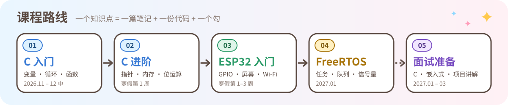

# 📚 课程

> 五门课，从第一行 `hello, world` 到嵌入式面试。



## 🗺️ 现在学到哪了

| | 课程 | 时间 | 学完能做什么 | 笔记 | 状态 |
| :-: | --- | --- | --- | :-: | :-: |
| 📘 | [**01 · C 入门**](01-c-basics) | 2026.11 – 12 中 | 不看答案独立写出 20 道简单题 | 2 | 🟨 |
| 📗 | [**02 · C 进阶**](02-c-advanced) | 寒假第 1 周 | 用指针写单链表，用位运算操作某一位 | 0 | ⬜ |
| 🔌 | [**03 · ESP32 入门**](03-esp32-basics) | 寒假第 1–3 周 | 屏幕显示表情，电机前进后退转圈 | 0 | ⬜ |
| ⚙️ | [**04 · FreeRTOS**](04-freertos) | 2027.01 | 小车代码拆成多个任务，用队列传指令 | 0 | ⬜ |
| 💼 | [**05 · 面试准备**](05-interview-prep) | 2027.01 – 03 | 每个常见问题能用中文讲 1–2 分钟 | 0 | ⬜ |

<sub>⬜ 没开始 · 🟨 进行中 · ✅ 完成</sub>

## 🔁 每学完一个知识点

| 📝 1. 笔记 | ⌨️ 2. 代码 | ✅ 3. 打勾 | 🚀 4. 提交 |
| --- | --- | --- | --- |
| 复制 [`NOTE_TEMPLATE.md`](NOTE_TEMPLATE.md) 到课程的 `notes/` | 例子自己敲一遍，再写 1–2 个小练习，放进 `code/` | 课程 README 里把 `- [ ]` 改成 `- [x]`，笔记表加一行 | `git add .`<br>`git commit -m "..."`<br>`git push` |

## 📁 每门课长这样

```
01-c-basics/
├── README.md          # 这门课的首页：笔记列表 + 知识点清单
├── notes/
│   └── 01-hello-c.md  # 笔记：编号-知识点.md
└── code/
    └── 01-hello-c.c   # 代码：和笔记同名
```

> [!IMPORTANT]
> CS50 的 problem set 答案**不要**放进这个公开仓库，这里只放笔记和自己写的练习。
