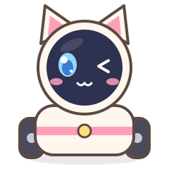

[🏠 首页](../README.md) › 🛠️ 项目

# 🛠️ 项目

> 把课程里学到的东西，做成一个真的能跑的东西。

| | 项目 | 一句话 | 状态 |
| :-: | --- | --- | :-: |
| 🐱 | [**AI 电子宠物小车**](ai-pet-car) | 会聊天 · 会做表情 · 会到处跑的桌面小伙伴 | ⬜ |

⬜ 没开始 · 🟨 进行中 · ✅ 完成

## 🐱 小车的文档从这里进

| | 想看什么 | 去哪里 |
| :-: | --- | --- |
| 👋 | 它是什么、怎么工作、做到哪一步了 | [项目首页](ai-pet-car) |
| 📝 | 详细的开发计划（9 个板块） | [docs/PLAN.md](ai-pet-car/docs/PLAN.md) |
| 🛒 | 要买哪些元件、在哪买、多少钱 | [hardware/BOM.md](ai-pet-car/hardware/BOM.md) |
| 🐛 | 开发过程和踩坑记录 | [docs/devlog/](ai-pet-car/docs/devlog) |

---

<a href="../leetcode">← 🧩 刷题</a> &nbsp;·&nbsp; <a href="../README.md">🏠 首页</a> &nbsp;·&nbsp; <a href="ai-pet-car">🐱 AI 电子宠物小车 →</a>

