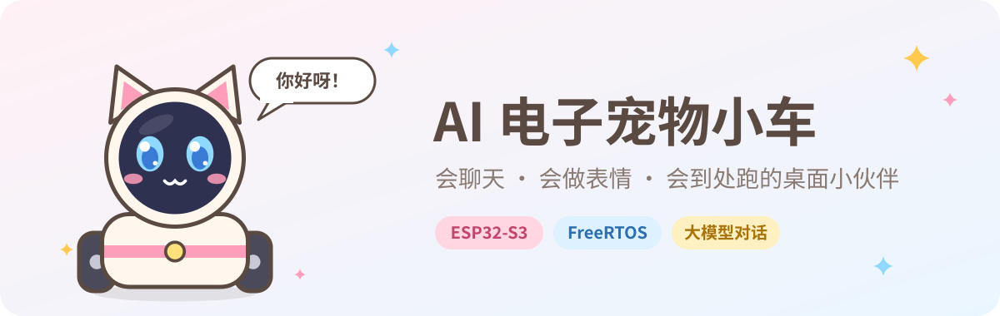
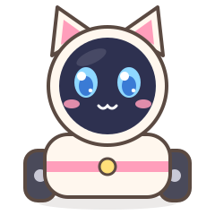
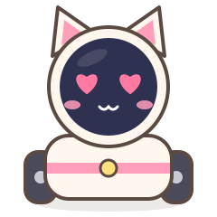
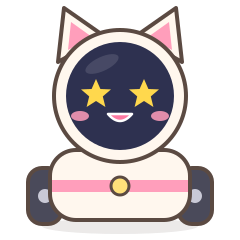
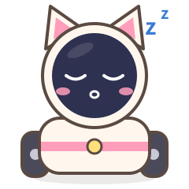
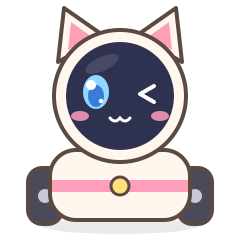
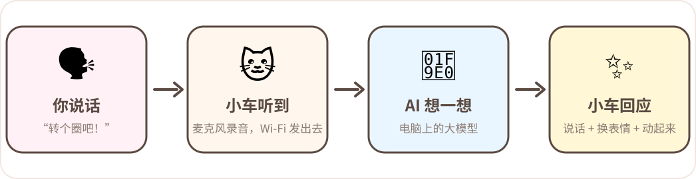

<div align="center">



<br>


**一台住在桌面上的小宠物车** 🐾<br>
你跟它说话，它会用声音回答你，圆圆的屏幕上会跟着变表情；<br>
你说“转个圈”“往前走”，它就真的动起来！

</div>

---

## 🐱 认识一下它

<table>
<tr>
<td align="center" width="16%"><br><sub>开心</sub></td>
<td align="center" width="16%"><br><sub>喜欢你</sub></td>
<td align="center" width="16%"><br><sub>好兴奋</sub></td>
<td align="center" width="16%"><br><sub>想一想</sub></td>
<td align="center" width="16%"><br><sub>困了</sub></td>
<td align="center" width="16%"><br><sub>眨眨眼</sub></td>
</tr>
</table>

> 这是它的设想形象：奶白色的身体、粉色腰带、带猫耳朵的圆屏脑袋。屏幕上的表情会根据聊天内容自己切换。

## ✨ 它是怎么工作的

<div align="center">

</div>

小车的“大脑”是一块巴掌大的开发板（**ESP32-S3**），负责听、说、显示表情和控制轮子；真正“思考”的部分交给电脑上的大模型（DeepSeek / Claude）。整体思路参考了开源项目“小智 AI”，但代码全部自己写。

## 🗺️ 大致步骤

| | 步骤 | 做完之后 |
| :-: | --- | --- |
| 📦 | **1. 备齐元件，逐个验货** | 开发板、麦克风、喇叭、屏幕都在面包板上亮起来 |
| 😊 | **2. 会做表情，会动** | 屏幕上有几种表情，轮子能前进、后退、转圈 |
| 🎤 | **3. 能听会说** | 能录下你的声音，也能把声音播出来 |
| 🧠 | **4. 接上 AI** | 你说一句话，它回答你，还会按你说的动起来 |
| 🚗 | **5. 装成一台车** | 装上底盘和电池，满桌子跑；再慢慢加“宠物感” |

## 📈 进度

- [ ] 📦 备齐元件，逐个验货
- [ ] 😊 会做表情，会动
- [ ] 🎤 能听会说
- [ ] 🧠 接上 AI
- [ ] 🚗 装成一台车

## 📚 想了解更多

| | 想看什么 | 去哪里 |
| :-: | --- | --- |
| 🛒 | 要买哪些元件、在哪买、多少钱 | [hardware/BOM.md](hardware/BOM.md) |
| 📝 | 详细的开发计划（9 个板块） | [docs/PLAN.md](docs/PLAN.md) |
| 🐛 | 开发过程和踩坑记录 | [docs/devlog/](docs/devlog) |
| 🔌 | 硬件、接线和供电 | [hardware/](hardware) |
| 💾 | 小车上的程序 | [firmware/](firmware) |
| ☁️ | 电脑上的 AI 服务 | [server/](server) |
| 🎬 | 照片和演示视频 | [media/](media) |

<details>
<summary>📁 <b>文件夹结构</b>（点开看看）</summary>

```
ai-pet-car/
├── README.md        # 你正在看的介绍
├── docs/
│   ├── PLAN.md      # 开发计划：9 个板块 + L0–L5 阶段
│   └── devlog/      # 调试记录，一个问题一篇
├── hardware/
│   ├── BOM.md       # 元件清单：买什么、哪里买、多少钱
│   ├── wiring/      # 接线图、引脚分配表
│   └── pcb/         # 自己画的电源 / 主板 PCB（后期）
├── firmware/        # 小车上的程序（ESP-IDF，C 语言）
├── server/          # 电脑上的 AI 服务（Python）
└── media/           # 照片、演示视频；art/ 里是吉祥物和插图
```

</details>

---

<div align="center">
<br>
<sub>插图都是为这个项目原创绘制的 SVG，放在 <a href="media/art">media/art</a>。</sub>
</div>
