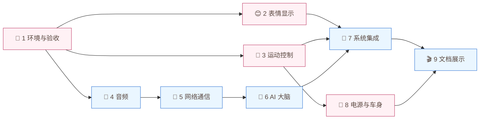

[🏠 首页](../../../README.md) › [🛠️ 项目](../../README.md) › [🐱 AI 电子宠物小车](../README.md) › 📝 开发计划

# 📝 AI 宠物小车 · 开发计划

> 整个项目分成 **9 个板块**，每个板块写了它要实现的功能、用到的硬件、能练到的技能。

> [!NOTE]
> 现在只到板块这一层，**详细步骤等开始做某个板块时再补进它的「🪜 详细步骤」小节**。硬件型号、购买渠道和价格见 [🛒 元件清单](../hardware/BOM.md)。

## 🧭 怎么读这份计划

同一个项目有三种拆法，回答三个不同的问题：

| 拆法 | 回答什么问题 | 在哪里 |
| --- | --- | --- |
| **5 个步骤** | 小车现在能做什么了 | [项目首页 · 步骤与进度](../README.md#steps) |
| **6 个阶段**（L0–L5） | 先做什么，后做什么 | [🚦 阶段](#stages) |
| **9 个板块** | 每一块功能具体要做哪些事 | [🗺️ 总览](#overview)，往下是每个板块的清单 |

不认识的缩写和名词可以查 [📖 术语表](../../../GLOSSARY.md)。

## 🚦 阶段（L0–L5）

阶段划分参考了已经做成的开源项目（小智 xiaozhi-esp32、ESP-SparkBot、aibot、esp32-s3-ai-robot 等），调研见[这份文档](https://claude.ai/artifact/2MzYh5NDjD8tnHYwonAe8V)。共同规律：先在面包板上把所有模块跑通，软件全部能用了再装上车身。

| 阶段 | README 步骤 | 内容 |
| --- | :-: | --- |
| **L0** 硬件验收 | 1 | 面包板接好主控、麦克风、功放、3.5 寸屏，用 8 MB 分区编译小智的 `bread-compact-wifi-lcd`（屏幕选 `ST7796 320*480 IPS`）烧进去，能和 xiaozhi.me 对话、屏上有表情 |
| **L1** 上手 | 1 | ESP-IDF v6.x 环境、点灯、串口、按键中断，加一个串口命令行用来手动测每个模块 |
| **L2** 表情 + 电机 | 2 | LVGL 在 3.5 寸屏上播 3–4 个表情；TB6612 PWM 控制前进、后退、原地转圈（车轮架空调）；用万用表量一次电机启动电流 |
| **L3** 听和说 + 最小服务端 | 3、4 | 先做音频回环（录音传到电脑存 WAV、电脑的 WAV 传回来播放）；再写最小 Python 服务（语音识别 → DeepSeek / Claude → edge-tts），WebSocket 收发音频，先用按键说话；测一次延迟 |
| **L4** 语音控制 + 上车 | 4、5 | 服务端用 function calling 定义 `move(direction, duration_ms)`、`spin(turns)`、`set_emotion(name)` 等工具，下发 JSON；ESP32 端用动作队列，每个动作限时，收不到心跳就停车；FreeRTOS 拆成音频、网络、显示、电机任务；装上底盘和 2S 电池 |
| **L5** 完善（挑着做） | 5 | 离线唤醒词（ESP-SR WakeNet）、本地宠物状态机、IMU 检测被拿起、测距避障、编码器 + PID 精准转圈、Opus 流式传输降延迟、电源做成自己的 PCB |

## 🗺️ 总览

| # | 板块 | 主要在哪个阶段做 | 依赖 |
| :-: | --- | --- | :-: |
| 🧰&nbsp;1 | [**开发环境与硬件验收**](#m1) 工具链装好，确认每个元件都是好的 | L0–L1 | 无 |
| 😊&nbsp;2 | [**表情显示**](#m2) 3.5 寸竖屏上的动漫少女形象、表情和动画 | L2，L5 再精修 | 1 |
| 🛞&nbsp;3 | [**运动控制**](#m3) 前进、后退、转圈，后面做到走直、转准 | L2，L5 做闭环 | 1 |
| 🎤&nbsp;4 | [**音频**](#m4) 能录、能播，后面能自己听到唤醒词 | L3，L5 加唤醒词 | 1 |
| 📡&nbsp;5 | [**网络与通信**](#m5) Wi-Fi、和服务端的通信协议 | L3–L4 | 1、4 |
| 🧠&nbsp;6 | [**AI 大脑（服务端）**](#m6) 语音识别 → 大模型 → 语音合成，下发动作 | L3–L4，L5 优化 | 5 |
| 🧩&nbsp;7 | [**系统集成与宠物行为**](#m7) 多任务调度、状态机、安全保护，把上面串起来 | L4，L5 加宠物感 | 2–6 |
| 🔋&nbsp;8 | [**电源与车身**](#m8) 电池、降压、底盘、外壳，最后做自己的 PCB | L4，L5 做 PCB | 3 |
| 🎬&nbsp;9 | [**文档与展示**](#m9) README、框图、实测数据、演示视频、写进简历 | 每个阶段都记，L4 后定稿 | 全部 |

> [!TIP]
> **建议顺序**：1 → 2 和 3（可以交替）→ 4 → 5 → 6 → 7 → 8，板块 9 从第一天起就随手记。

---

## 🧰 1 · 开发环境与硬件验收

`🚦 阶段：L0–L1` · `🔗 依赖：无`

> 🎯 **目标**：开发环境能编译、烧录、调试；所有元件在面包板上验收过，以后出问题能排除硬件。

🔧 **用到的硬件**：ESP32-S3-DevKitC-1-N8R8、ICS-43434、MAX98357A + 喇叭、Waveshare 3.5 寸屏、面包板

📚 **能练到**：ESP-IDF 工程结构、GPIO、中断、menuconfig、看数据手册

✅ **要实现的功能**

- [ ] 装好 ESP-IDF v6.x，能编译、烧录、看串口日志
- [ ] 面包板接好主控、麦克风、功放、3.5 寸屏，编译烧录小智的 `bread-compact-wifi-lcd`，能和 xiaozhi.me 对话
- [ ] 自己写点灯、串口、按键中断
- [ ] 串口命令行：后面每个模块都能用命令手动触发
- [ ] 一张引脚分配表（`hardware/` 下），避开 GPIO35–37

🪜 **详细步骤**：_（开始做时补充）_

<a href="#overview">⬆ 回到总览</a>

---

## 😊 2 · 表情显示

`🚦 阶段：L2，L5 再精修` · `🔗 依赖：板块 1`

> 🎯 **目标**：屏幕上有一个有性格的动漫少女（半身），表情能被其他板块随时切换。

🔧 **用到的硬件**：Waveshare 3.5" IPS 电容触摸屏（ST7796S + FT6336U）

📚 **能练到**：SPI、DMA、LVGL、帧率和内存的取舍

✅ **要实现的功能**

- [ ] SPI 驱动 ST7796S 屏（竖屏 320×480），刷一张图
- [ ] 接入 LVGL，显示 3–4 个静态表情（开心、难过、思考、困）
- [ ] 表情动画：眨眼、说话时嘴巴动。身体整张图只画一次，之后只重画眼睛和嘴巴那一小块（局部刷新）
- [ ] 读 FT6336U 触摸，摸摸屏幕有反应
- [ ] 对外提供 `set_emotion(name)` 接口，供 AI 和状态机调用
- [ ] （L5）自己设计的动漫形象和更多动画，存在 Flash 里

📐 **算一算**

- 一整屏 320×480 × 2 字节（RGB565）≈ 300 KB，放不进芯片内部 512 KB 内存，所以帧缓存放 PSRAM（N8R8 有 8 MB，够用）。
- SPI 40 MHz 时整屏刷新最多约 16 帧/秒，80 MHz 约 32 帧/秒；只刷眼睛、嘴巴的小区域就能轻松几十帧。
- 角色图要压缩后存 Flash；图太多就用屏幕背面的 TF 卡槽。
- 引脚：屏幕 6 根（SCK、MOSI、CS、DC、RST、背光），触摸 4 根（SDA、SCL 可和陀螺仪共用，加 INT、RST）。

🪜 **详细步骤**：_（开始做时补充）_

<a href="#overview">⬆ 回到总览</a>

---

## 🛞 3 · 运动控制

`🚦 阶段：L2，L5 做闭环` · `🔗 依赖：板块 1`

> 🎯 **目标**：小车能按指令运动，最终做到走得直、转得准。

🔧 **用到的硬件**：Pololu TB6612FNG、Pololu 带编码器减速电机 ×2、轮子、万向球

📚 **能练到**：PWM（LEDC / MCPWM）、编码器计数（PCNT）、PID

✅ **要实现的功能**

- [ ] TB6612 + PWM 控制两个电机的速度和方向（车轮架空调）
- [ ] 基本动作：前进、后退、左转、右转、原地转圈、停
- [ ] 每个动作带时长，到时自动停
- [ ] 对外提供 `move(direction, duration_ms)`、`spin(turns)` 接口
- [ ] （L5）读编码器测转速，PID 闭环，让两个轮子同速、转一圈就是 360°

🪜 **详细步骤**：_（开始做时补充）_

<a href="#overview">⬆ 回到总览</a>

---

## 🎤 4 · 音频

`🚦 阶段：L3，L5 加唤醒词` · `🔗 依赖：板块 1`

> 🎯 **目标**：能清楚地录到你的声音，能流畅地播放回复。

🔧 **用到的硬件**：ICS-43434 麦克风、MAX98357A 功放 + 喇叭

📚 **能练到**：I2S、DMA 缓冲、环形缓冲区、音频格式

✅ **要实现的功能**

- [ ] I2S 读麦克风，录 3 秒传到电脑存成 WAV，听得清
- [ ] I2S 写功放，播放电脑传来的音频，不卡顿
- [ ] 按键说话：按住录音，松开发送
- [ ] 播放时关麦，避免听到自己说话
- [ ] 采样率和服务端对齐（参考别人踩过的 22050 / 16000 Hz 坑）
- [ ] （L5）离线唤醒词（ESP-SR WakeNet）
- [ ] （L5）Opus 编解码，减少传输量

🪜 **详细步骤**：_（开始做时补充）_

<a href="#overview">⬆ 回到总览</a>

---

## 📡 5 · 网络与通信

`🚦 阶段：L3–L4` · `🔗 依赖：板块 1、4`

> 🎯 **目标**：ESP32 和服务端之间有一条稳定的双向通道，能传音频，也能传指令。

🔧 **用到的硬件**：ESP32-S3 自带 Wi-Fi

📚 **能练到**：Wi-Fi 事件处理、WebSocket、协议设计、JSON 解析

✅ **要实现的功能**

- [ ] 连 Wi-Fi，断线自动重连
- [ ] WebSocket 客户端：上传音频、接收音频
- [ ] 定一个简单协议：音频帧、文字、动作指令（JSON）、心跳各用什么格式
- [ ] 心跳：收不到就让运动板块停车
- [ ] （可选）手机配网，不用把 Wi-Fi 密码写死在代码里

🪜 **详细步骤**：_（开始做时补充）_

<a href="#overview">⬆ 回到总览</a>

---

## 🧠 6 · AI 大脑（服务端）

`🚦 阶段：L3–L4，L5 优化` · `🔗 依赖：板块 5`

> 🎯 **目标**：电脑上跑一个 Python 服务，听懂你说的话，给出回答和动作。

🔧 **用到的硬件**：你的电脑

📚 **能练到**：Python 异步服务、大模型 API、function calling

✅ **要实现的功能**

- [ ] 最小版本：收到音频 → 语音识别 → DeepSeek / Claude → edge-tts → 回传音频
- [ ] 宠物人设的 system prompt（性格、说话风格、回答要短）
- [ ] function calling：定义 `move`、`spin`、`set_emotion` 等工具，大模型决定什么时候调用
- [ ] 记录每一步耗时，算出端到端延迟
- [ ] （L5）流式识别和流式合成，边说边回，降延迟
- [ ] （L5）短期记忆：记得刚才聊过什么

🪜 **详细步骤**：_（开始做时补充）_

<a href="#overview">⬆ 回到总览</a>

---

## 🧩 7 · 系统集成与宠物行为

`🚦 阶段：L4，L5 加宠物感` · `🔗 依赖：板块 2–6`

> 🎯 **目标**：把所有板块串成一个整体，并且让它像个宠物而不是遥控车。

🔧 **用到的硬件**：全部；可选 LSM6DSOX、VL53L0X、触摸模块

📚 **能练到**：FreeRTOS 任务、队列、优先级、状态机设计，这一块是面试最常追问的

✅ **要实现的功能**

- [ ] FreeRTOS 拆成音频、网络、显示、电机几个任务，定好优先级并写下理由
- [ ] 任务之间用队列传消息（例如服务端的动作指令 → 电机任务的动作队列）
- [ ] 整机状态机：待机 → 听 → 想 → 说 / 动 → 待机，每个状态有对应表情
- [ ] 安全保护：动作限时、断网停车、看门狗
- [ ] （L5）本地宠物行为：没人理它时会发呆、眨眼、偶尔动一下，断网也有反应
- [ ] （L5）传感器反应：被拿起来（IMU）、前面有障碍（测距）、摸头（触摸）

🪜 **详细步骤**：_（开始做时补充）_

<a href="#overview">⬆ 回到总览</a>

---

## 🔋 8 · 电源与车身

`🚦 阶段：L4，L5 做 PCB` · `🔗 依赖：板块 3`

> 🎯 **目标**：脱离 USB，用电池在桌上自由跑，跑起来不重启。

🔧 **用到的硬件**：2S 锂电、ISDT 充电器、Pololu D24V50F5、电容、开关、底盘板

📚 **能练到**：电源设计、ADC、画 PCB（你的 RF 板经验在这里用得上）

✅ **要实现的功能**

- [ ] 电源方案：2S 锂电直供电机，Pololu 降压 5 V 给 ESP32 和功放，加总开关和去耦电容
- [ ] 测电机启动时的峰值电流和电压跌落，确认不会触发 brownout
- [ ] 电池电压检测（ADC 分压），低电量时换表情提醒
- [ ] 底盘：固定电机、电池、主控、屏幕，麦克风和喇叭隔开 5 cm 以上
- [ ] 3.5 寸屏竖装（模块 61×92 mm）会让车变高、重心变高：电池压在底盘最低处，实测会不会翻，必要时换更大的轮子
- [ ] 测续航
- [ ] （L5）把电源和接线做成自己的 PCB，替掉面包板

🪜 **详细步骤**：_（开始做时补充）_

<a href="#overview">⬆ 回到总览</a>

---

## 🎬 9 · 文档与展示

`🚦 阶段：每个阶段都记，L4 后定稿` · `🔗 依赖：全部板块`

> 🎯 **目标**：项目做到哪一步都能拿出来讲，面试官能在 2 分钟内看懂你做了什么。

📚 **能练到**：把技术讲清楚，这在国内面试里很吃分

✅ **要实现的功能**

- [ ] 每个板块做完写一段调试记录（`docs/`）：遇到什么问题、怎么定位、怎么解决
- [ ] 系统框图和接线图（`hardware/`）
- [ ] 实测数据：对话延迟、峰值电流、续航、帧率
- [ ] 演示视频（`media/`）
- [ ] 本文件「结果」一节填上数据
- [ ] 中英文简历各写一条项目经历

🪜 **详细步骤**：_（开始做时补充）_

<a href="#overview">⬆ 回到总览</a>

---

## 🏆 结果（完成后填写）

| 指标 | 结果 |
| --- | --- |
| ⏱️ 说话到开始回复的延迟 | |
| 🎮 支持的动作指令 | |
| 🔋 续航 | |
| 🎬 演示视频 | |

---

<a href="../README.md">← 🐱 项目首页</a> &nbsp;·&nbsp; <a href="../hardware/BOM.md">🛒 元件清单 →</a>

