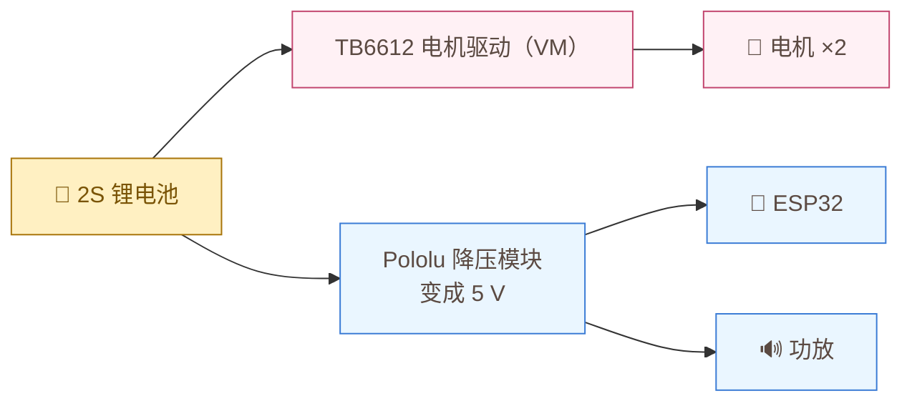

[🏠 首页](../../../README.md) › [🛠️ 项目](../../README.md) › [🐱 AI 电子宠物小车](../README.md) › 🔌 硬件

# 🔌 hardware · 硬件

> 买什么、怎么接线、怎么供电。

| | 内容 | 位置 |
| :-: | --- | --- |
| 🛒 | 元件清单（买什么、哪里买、多少钱） | [BOM.md](BOM.md) |
| 🧵 | 接线图、引脚分配表 | [wiring/](wiring) |
| 🟩 | 自己画的 PCB（后期） | [pcb/](pcb) |

## 🔋 供电方式

2S 锂电池直接给电机驱动（TB6612 的 VM），再经 Pololu 降压模块变成 5 V 给 ESP32 和功放，两路分开，避免电机启动时拉低电压导致主控重启。电机是 6 V 的，软件里限制 PWM 占空比来保护它。桌面调试阶段主控用 USB 供电，电机单独接电池。

---

<a href="../README.md">← 🐱 项目首页</a> &nbsp;·&nbsp; <a href="BOM.md">🛒 元件清单 →</a>

