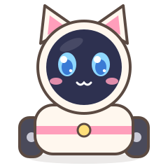
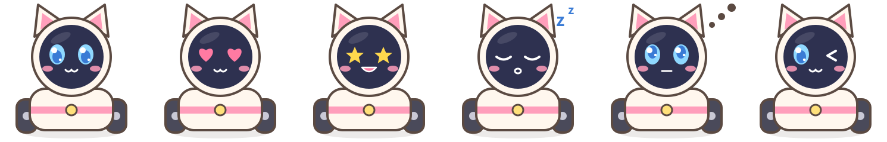

[🏠 首页](../../../README.md) › [🛠️ 项目](../../README.md) › [🐱 AI 电子宠物小车](../README.md) › 🎬 照片和视频

# 🎬 media · 照片和视频

> 接线照片、演示视频（大文件放网盘或 B 站 / YouTube，这里只放链接和小图）。

## 🎨 插图

[`art/`](art) 里是为这个项目原创绘制的 SVG 插图（吉祥物、横幅、流程图），可以直接在文档里引用：

屏幕看板娘 **小橙 Cora** 的立绘和设定在 [`art/cora/`](art/cora)。

首页横幅 [`banner-repo.svg`](art/banner-repo.svg) 右边的角色是《某科学的超电磁炮》的御坂美琴，Q 版同人绘制：用 [`art/src/draw_banner_repo.py`](art/src/draw_banner_repo.py) 一笔一笔画出来的，没有使用官方图片，角色版权归原作者和版权方所有。

---

<a href="../README.md">← 🐱 项目首页</a> &nbsp;·&nbsp; <a href="art/cora">🍊 小橙 Cora →</a>

